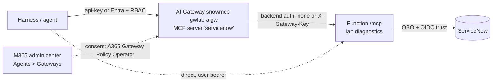

# AI Gateway / ServiceNow governance PoC

Status: **lab executed 2026-10-15; resources left running** (environment
`snowmcp-gwlab`, resource group `rg-snowmcp-gwlab`, Sweden Central). Tear down
with [runbook 99](runbooks/99-teardown.md).

Question: can the ServiceNow MCP server (Entra OBO, MCP Apps widgets) be put
behind the Azure API Management **AI Gateway tier** and governed centrally from
the Microsoft 365 admin center / Agent 365, without losing per-user identity?

Short answer: **not today.** The gateway strips the caller's token, so OBO and
ServiceNow per-user attribution fail. Widgets fail because `resources/*` and
`_meta` are not federated. Gateway-side tool block and rate limit work. M365
discovery did not pick up the AI Gateway tier server. Details: [findings](findings.md).

## Start here

- [Findings, documentation diff, Czech summary](findings.md)
- [Experiment log with predictions and evidence](experiment-log.md)
- Screenshots and raw evidence: kept locally in `screenshots/` and `evidence/` (not published; they contain tenant identifiers). Docs reference them by file name.

## Architecture under test

## Runbooks

| # | Runbook | Executed |
|---|---|---|
| 00 | [Preflight](runbooks/00-preflight.md) | yes |
| 01 | [Lab environment](runbooks/01-lab-environment.md) | yes |
| 02 | [AI Gateway and MCP server](runbooks/02-ai-gateway.md) | yes |
| 03 | [M365 admin center consent and discovery](runbooks/03-m365-admin-center.md) | consent yes, discovery blocked |
| 04 | [M365 agent via gateway](runbooks/04-m365-agent-via-gateway.md) | no (Track A result) |
| 05 | [Copilot Studio](runbooks/05-copilot-studio.md) | no (optional) |
| 06 | [Close the bypass](runbooks/06-close-the-bypass.md) | D1, D3 yes; D4 no |
| 07 | [Observability / Defender](runbooks/07-defender-hunting.md) | no |
| 08 | [Classic APIM v2 comparison](runbooks/08-classic-apim-v2-comparison.md) | no (recommended next) |
| 09 | [BYO MCP comparison](runbooks/09-byo-mcp-comparison.md) | no |
| 99 | [Teardown](runbooks/99-teardown.md) | script ready, not run |

## Lab code (all flags default off)

- `LAB_REQUEST_DIAGNOSTICS=true`: one redacted line per `/mcp` request
  (presence flags and token claim shape only), `src/utils/labGateway.ts`.
- `REQUIRE_GATEWAY_HEADER=true` + `GATEWAY_SHARED_SECRET` (Key Vault
  reference): reject `/mcp` calls without a matching `X-Gateway-Key`
  (constant-time compare).
- Harness: `scripts/lab/ai-gateway/run-experiments.mjs`
  (`--scenario list|call|B1|B2|B3|poll|burst --target gateway|direct`).
  Gateway URL and key are read from `.azure/snowmcp-gwlab/lab.env`, never committed.

## Current lab state

- Gateway MCP server `servicenow`: `report_incident` blocked, request rate
  limit 5/60 s, backend header `X-Gateway-Key`, user has AI Gateway Tools User.
- Function: diagnostics on, `REQUIRE_GATEWAY_HEADER=false` (direct OBO path works).
- M365: Azure gateway consent granted and connected; diagnostic custom role
  on the gateway for the Agent 365 service principal.
