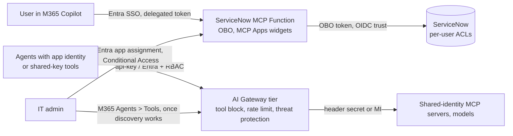

# Findings: ServiceNow MCP server behind the Azure API Management AI Gateway tier

Lab date 2026-10-15, tenant the lab tenant, Sweden Central. Everything here was
observed live unless marked *not run*. Raw evidence: [experiment log](experiment-log.md).

## 1. Identity verdict (the central question)

**A per-user, OBO-based MCP server such as this one cannot sit behind the AI
Gateway tier today without losing user attribution and ServiceNow ACLs.**

| Path | Caller auth at gateway | What reaches the Function | Result |
|---|---|---|---|
| Direct (today) | n/a | user bearer (`access_as_user`) | OBO works, `<incident-1>` / `<incident-2>` created as the user |
| Gateway, `api-key` only | key | no `Authorization` | 401 from backend -> `isError` "Federated tool invocation failed with status 401" |
| Gateway, `api-key` + user bearer | - | - | **400** at the gateway (credentials cannot be combined) |
| Gateway, Entra token (`https://azure-api.net/aigateway/Data.All`) + RBAC | Entra | **no `Authorization`** (`present_bearer=false`) | same 401; the token's audience is the gateway anyway |
| Gateway, backend auth OAuth 2.0 / managed identity | any | one gateway-held identity | *not run*; by design every call is the same identity (identity collapse) |

The gateway terminates caller auth and strips the caller's `Authorization`
header. There is no pass-through or OBO option for MCP backends. The pattern that
keeps per-user identity today is the **direct path** (or BYO MCP / classic APIM v2
with `Authorization` pass-through, spec A5 / F3, *not run*).

## 2. MCP Apps verdict

**Widgets do not survive the gateway.** The federated endpoint advertises
`tools` only: `resources/list`, `resources/read`, `resources/templates/list`
and `prompts/list` return 400 "Method not supported". `tools/list` keeps names,
descriptions and `inputSchema`, but drops `annotations` and `_meta` (including
the `ui` resource binding). `serverInfo` becomes "Azure API Management".
Structured content could not be checked end to end because OBO tools fail (section 1).

## 3. What IT can govern centrally, and how fast

| Control | Where | Result |
|---|---|---|
| Inventory in Microsoft 365 admin center | M365 > Agents > Tools | **Blocked.** Consent succeeds, API says `aiGatewayStatus: Ready`, but no gateway server appeared in 27+ min. Root cause candidate: the consent role covers `Microsoft.ApiManagement/service/*` only, the AI Gateway tier is `Microsoft.ApiManagement/aigateways` (evidence (local: `evidence/m365-discovery-gap-consent-role.json`)) |
| Server block from M365 (403 `AccessBlockedByGateway`) | M365 | *Not testable* (no discovery) |
| Tool block | Gateway portal, MCP server > Tools > Blocked tools | **Works.** Propagation at most 41 s. Denial = 200 + `isError` + `_meta` `ToolNotAvailable` + correlationId. The tool **stays in `tools/list`** |
| Request rate limit per caller | Gateway Policies | **Works, approximate.** 5/60 s let 9 of 12 burst calls through, then 429 + `retry-after` |
| Agent 365 tool threat protection, IP filter | Gateway Policies | Available for MCP servers; *not run* (licensing) |
| Content safety, token limits | Gateway Policies | Models only, not MCP servers |
| Caller authorization per MCP server | Gateway RBAC "AI Gateway Tools User" | Works; API keys are gateway-wide |

## 4. Bypasses and the controls that close them

| Bypass | Proof | Control | Cost of the control |
|---|---|---|---|
| Any holder of a user token calls the Function `/mcp` directly (incl. the repo's M365 agent) | D1: tool blocked at gateway, direct call created `<incident-2>` | `REQUIRE_GATEWAY_HEADER=true` + gateway backend header `X-Gateway-Key` from Key Vault: direct -> 403 | Kills per-user OBO, because the gateway path carries no user (section 1) |
| Power Platform ServiceNow connector reaches the same instance | Visible as "ServiceNow - Power Platform connector" in M365 Tools (screenshot (local: `screenshots/53-m365-tools-not-discovered-after-27min.png`)) | Power Platform data policy (spec E3) | *Not run* |
| Network reachability of the Function | - | Private endpoint / access restrictions (spec D4) | *Not run*; same identity trade-off plus cost |

## 5. Public documentation vs. reality

| # | Documentation says | Reality in tenant | Evidence |
|---|---|---|---|
| 1 | Quickstart management API `2026-05-01-preview` | RP returns `NoRegisteredProviderFound`; supported are `2025-09-01-preview`, `2026-05-01`, `2026-09-01-preview` (lab used the last) | versions (local: `evidence/aigateway-api-versions.json`), screenshot (local: `screenshots/quickstart-api-version.png`) |
| 2 | Threat protection PATCH uses `2025-09-01-preview` | Valid, but differs from the quickstart's version; readers get two versions for one resource | screenshot (local: `screenshots/threat-policy-api-version.png`) |
| 3 | UI: creation takes 8-10 minutes | About 1 minute | screenshot (local: `screenshots/14-aigw-creating.png`) |
| 4 | Agent 365 needs "a static list of allowed tools" per MCP server | Wizard offers only Allow all / name pattern + Blocked list | tools step (local: `screenshots/23-aigw-tools-step.png`), edit (local: `screenshots/36-aigw-edit-tools-step.png`) |
| 5 | Entra caller auth implied, scope not documented | Scope `https://azure-api.net/aigateway/Data.All` only in portal "Continue in code" | screenshot (local: `screenshots/34-aigw-cli-token-snippet.png`) |
| 6 | Entra ID access tab not described | Exists, assigns AI Gateway User / Tools User / Models User per server | screenshot (local: `screenshots/28-aigw-access-entra-add.png`) |
| 7 | API key per owner | No owner field on key creation | screenshot (local: `screenshots/27-aigw-create-api-key-dialog.png`) |
| 8 | Consent: "Enable Azure API Management service and AI Gateway" toggle | First a consent checkbox, then the switch appears; plus a LiteLLM option | 46 (local: `screenshots/46-m365-gateways-panel.png`), 47 (local: `screenshots/47-m365-gateways-consent-ticked.png`), 48 (local: `screenshots/48-m365-gateways-azure-connected.png`) |
| 9 | Role "A365 MCP Gateway Policy Operator" | Role is named "A365 Gateway Policy Operator" | evidence (local: `evidence/m365-discovery-gap-consent-role.json`) |
| 10 | Servers appear under Agents > Tools with publisher "AI Gateway" | Not discovered after 27+ min; Source filter has only Catalog / Not applicable | 49 (local: `screenshots/49-m365-tools-after-consent.png`), 50 (local: `screenshots/50-m365-tools-source-filter.png`), 53 (local: `screenshots/53-m365-tools-not-discovered-after-27min.png`) |
| 11 | Discovery of "resources of type `Microsoft.ApiManagement`" | Consent role lacks every `aigateways/*` action | evidence (local: `evidence/m365-discovery-gap-consent-role.json`) |
| 12 | (not documented) | ARM `PUT` toolServer echoes backend header secrets in plaintext; `GET` masks them | D3 (local: `evidence/runs/D3-backend-locked-to-gateway.txt`) |
| 13 | Region | Create dialog defaults to East US 2, not the RG region | screenshot (local: `screenshots/12-aigw-create-dialog-defaults.png`) |
| 14 | Pricing | Preview price not published | screenshot (local: `screenshots/preview-pricing-unpublished.png`) |

## 6. Preview limitations and data residency

Preview hits: items 4, 10, 11 and 12 above; federated MCP is tools-only; no
caller-identity forwarding. Placement: Function, Key Vault, Storage, App
Insights, gateway and its MCP server all in **Sweden Central**. Agent 365 / M365
admin data stays in the tenant's M365 geo. The ServiceNow developer instance
region was not verified.

Cost: AI Gateway preview showed no charges. Main meters: two private endpoints
(about USD 0.48/day), Flex Consumption executions, Log Analytics ingestion. Total
lab spend is well under the USD 20 budget. No model or content safety resource
was deployed.

## 7. Recommended reference architecture (today)

Keep per-user, widget-based MCP servers on the direct Entra OBO path, governed
with Entra (app assignment, Conditional Access, token scope) plus the server's
own tool flags. Put shared-identity tools and models behind the gateway. Revisit
when the gateway supports caller-token pass-through or OBO and `resources/*`.

## 8. Open questions for the product groups

1. AI Gateway: is caller `Authorization` pass-through or OBO for MCP backends planned? Why is api-key + Authorization rejected with 400?
2. AI Gateway: will federated MCP support `resources/*`, `prompts/*`, `annotations` and `_meta` (MCP Apps)?
3. AI Gateway: should a blocked tool be removed from `tools/list`? How should a "static list of allowed tools" be configured?
4. Agent 365: does the consent role need `Microsoft.ApiManagement/aigateways/*` actions for AI Gateway tier discovery?
5. Agent 365: what is the expected discovery latency, and is there a status or log for failed discovery?
6. ARM: should `PUT` on a toolServer echo credential values?

## 9. Security notes from the lab

- The first `X-Gateway-Key` value was printed from a `PUT` response and rotated at once. The current value was never printed.
- Rotate the `lab-harness` gateway key (visible in an earlier browser snapshot) and the ServiceNow admin password (shared in chat).
- Side finding: `report_incident` is annotated `readOnlyHint: true` in `src/tools/index.ts` although it creates a record.

## Shrnutí (česky)

- ServiceNow MCP server s per-user OBO **nelze dnes provozovat za AI Gateway** bez ztráty identity uživatele: brána hlavičku `Authorization` volajícího nepřeposílá, kombinace api-key + token vrací 400.
- **MCP Apps widgety přes bránu nefungují**: `resources/*` a `prompts/*` vrací 400, z `tools/list` mizí `annotations` a `_meta`.
- **Blokace nástroje na bráně funguje** do cca 40 s se zdokumentovanou odpovědí `ToolNotAvailable`; blokovaný nástroj ale v `tools/list` zůstává.
- **Rate limit funguje**, ale přibližně (9 z 12 volání prošlo při limitu 5).
- **Inventář v Microsoft 365 admin center se nenaplnil**: souhlas proběhl, ale role "A365 Gateway Policy Operator" pokrývá jen `Microsoft.ApiManagement/service`, ne nový typ `aigateways`.
- **Obejití brány je triviální**: s platným uživatelským tokenem jde volat Function přímo; uzavřít to lze sdíleným tajemstvím (403 pro přímá volání), ale tím zmizí OBO.
- Dokumentace se v několika bodech liší od reality (verze API, název role, "statický seznam nástrojů", rozsah tokenu) - viz tabulka v sekci 5.
- Doporučení: per-user MCP servery nechat na přímé Entra OBO cestě, bránu použít pro sdílené identity a modely.
